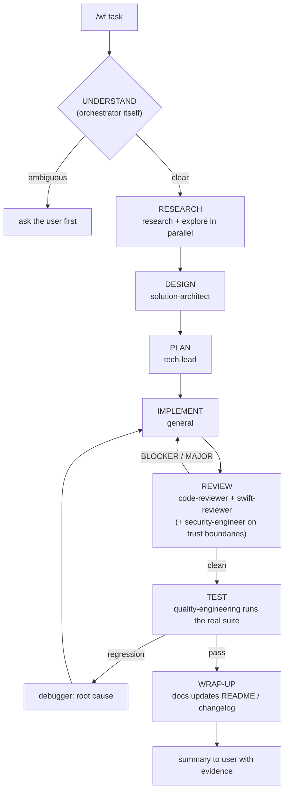

# OpenCode V2 Multi-Agent Workflow Setup

How to configure **OpenCode V2** (the coding agent at `opencode.ai` — a different
product from Claude Code) so a fleet of specialist subagents runs a full
research → dev → test pipeline under one primary orchestrator, with sync-time
permission hardening. Like `orchestrator-only-setup.md`, this is a
personal-machine configuration (not part of this repo's `install.sh`); it
exists so it can be replicated on another machine or audited later.

Config lives in `~/.config/opencode/`. Everything below was verified against a
running V2 service via its HTTP API on 2026-10-16.

---

## 1. What this setup does

OpenCode V2 has no built-in pipeline engine. Orchestration is a pattern, not a
feature: one `primary`-mode agent (the orchestrator) dispatches stages to
`subagent`-mode specialists through the `subagent` tool, and each stage hands
off to the next through **files on disk**, because every subagent starts with
fresh context and sees nothing from the parent session.

The machine already had 19 specialist subagents (synced from Claude Code
definitions — see §5), so the additions were:

1. A `orchestrator` Markdown agent that encodes the pipeline, bounded loops,
   and hard rules (never push/PR without the user, real exit codes or it
   didn't happen).
2. Two slash commands (`/wf`, `/wf-status`) as deterministic entry points.
3. A hardening section in the sync script so every synced subagent gets
   least-privilege permissions for skills and MCP tools — enforced by the
   engine, not by prompts.

## 2. The pipeline



Loop caps: max 3 review cycles, max 3 debug cycles; NITs batch at the end.
Hitting a cap stops the run and reports options instead of looping silently.

Every stage writes its artifact to `docs/workflow/<slug>/` (`research.md`,
`design.md`, `plan.md`, `log.md`). The file is the handoff — the next stage's
subagent reads it from disk, which also gives the user an audit trail.
`/wf-status` reads the newest run's `log.md`.

## 3. Orchestration mechanics (OpenCode V2)

| Mechanism | How it is used here |
| --- | --- |
| Agent modes | Workers are `mode: subagent`; only `orchestrator` is `primary`. The session's default agent stays `build`, so ordinary chats are unaffected — `/wf` is the only way in. |
| `subagent` permission | Orchestrator sets `deny subagent *` first, then `allow` for its 11 workers (last matching rule wins). The orchestrator physically cannot dispatch to anything else. Flat hierarchy: synced workers all carry `deny subagent *`, so none of them spawns grandchildren. |
| Routing | The parent model picks workers by their `description` text. Descriptions are written as "Use when …" triggers. |
| Context isolation | Each dispatch prompt must carry the task + paths of prior artifacts; results come back as summaries only. This is why artifacts live on disk. |
| Commands | `commands/wf.md` sets `agent: orchestrator`, so `/wf` switches the session to the orchestrator before submitting the prompt. |

## 4. Where the files live

```text
~/.config/opencode/
├── opencode.json                  # agents map — REGENERATED by sync-from-claude.py, do not hand-edit
├── agents/orchestrator.md         # Markdown agent: frontmatter = config, body = system prompt
├── commands/wf.md                 # /wf — entry point (agent: orchestrator)
├── commands/wf-status.md          # /wf-status
├── sync-from-claude.py            # mirrors ~/.claude/agents/*.md into opencode.json + appends hardening
└── opencode.json.pre-*            # dated backups taken before each hardening run
```

`orchestrator.md` frontmatter carries `mode`, `color`, and the subagent
allowlist; the Markdown body is the system prompt (stage order, caps, hard
rules, "reply to the user in Thai"). OpenCode merges agent definitions from
all sources; the `.md` files are not touched by the sync script, which only
rewrites the `agents` key of `opencode.json` — that separation is what keeps
the workflow survivable across re-syncs.

## 5. Sync-time permission hardening

`sync-from-claude.py` mirrors `~/.claude/agents/*.md` (Claude Code frontmatter
+ prompt) into OpenCode's `agents` map, converting a Claude `tools:` allowlist
into deny rules for unlisted edit/shell/web/read tools. Because the script
rewrites the whole `agents` key on every run, per-agent permissions must live
in the script itself — a `hardening(name)` function appends deny rules after
the generic ones. Permissions are ordered rules where the **last match wins**,
so appended denies refine (or override) the generic baseline.

The hardening mapping, and the reasoning behind each line:

| Rule | Applied to | Why |
| --- | --- | --- |
| deny `my-memory_*` | all 19 | Subagents digest untrusted web/file content; a memory-write MCP is a persistent indirect-prompt-injection channel. Memory writes belong to interactive/orchestrator sessions. |
| deny `drawdy_*`, `figcraft*` | all 19 | Whiteboard/design MCP servers are in nobody's job description here. |
| deny `XcodeBuildMCP_*` | 16 analysis/review/planning agents | No device/build actions from read-only roles. |
| keep `XcodeBuildMCP` | `debugger` (logs/LLDB), `quality-engineering` (runs the test suite), `devops-engineer` (build automation) | These three need device/build access; denying would break the pipeline's TEST stage. |
| deny `skill` | 7 agents whose prompts never load skills | Skills are advertised to every agent; deny hides them. `code-reviewer` (uses `scrutinize`) and `debugger` (uses `diagnose`) must keep skill access — check the agent's prompt before denying. |
| deny `edit` + `shell` | `code-reviewer`, `swift-reviewer`, `ui-reviewer` | Reviewers report findings; the implementer applies fixes. Their Claude-side definitions had no `tools:` line (all tools), so this pins them read-only at the engine level. |
| deny `shell` (keep `edit`) | `wiki-updater` | It writes vault files by design but never runs commands. |

Two lessons from applying this:

- **Read the agent's prompt before denying a tool.** Two agents that looked
  safely deniable actually depended on a skill by name. Grep the synced
  `.md` bodies for `skill`/tool references first.
- **deny of `edit`/`shell` does not imply MCP is denied.** The synced
  read-only reviewers could still build, run, and erase simulators through
  MCP until `XcodeBuildMCP_*` was explicitly denied — tool-category denies and
  MCP denies are independent rule sets.

## 6. Verifying the setup

The background service exposes the live merged config:

```sh
opencode api get /api/agent     # agents, modes, effective permissions
opencode api get /api/command   # slash commands
```

Assert against this, not against the files: for each synced agent, the four
MCP denies exist; `XcodeBuildMCP_*` is denied exactly on the 16-list and
absent for `debugger`/`quality-engineering`/`devops-engineer`; `skill` denied
exactly on the 7-list; reviewers carry `edit`+`shell` denies;
`wiki-updater` denies `shell` but not `edit`; `orchestrator` is `mode:
primary` with 11 subagent allows. Built-ins (`build`, `plan`, `general`,
`explore`, and the hidden maintenance agents) appear with capitalized display
names but lowercase ids — the orchestrator's allowlist uses the lowercase ids.

## 7. Replicating on another machine

1. Install OpenCode V2 and sign in to a provider (`/connect`).
2. Configure the MCP servers you actually have under `mcp.servers`; the
   hardening denies are harmless if a named server is absent.
3. Copy `sync-from-claude.py` (or just its `hardening()` section into your own
   mirror script) and run it: `python3 ~/.config/opencode/sync-from-claude.py`.
4. Copy `agents/orchestrator.md`, `commands/wf.md`, `commands/wf-status.md`
   from this machine (or from the vault snapshot of this doc's date).
5. Back up `opencode.json` before the first run; run the verification in §6.

## 8. Known gaps and follow-ups

- Built-in agents (`build`, `plan`, `general`, `explore`) have default
  permissions — `general` (the pipeline's implementer) can use every MCP
  server. Acceptable for a single-user machine; not for shared ones.
- `quality-engineering` has `shell` denied by its Claude-side `tools:` line,
  so its only path to running a suite is `XcodeBuildMCP` — iOS projects work
  end to end; for non-iOS suites the orchestrator must run tests itself.
- Workflow prompts still need a real-task shakedown; expect to tune stage
  wording after the first run or two (~5 min per iteration).
- The stage prompts embed personal conventions (never push/PR without the
  user, Thai replies). Adjust before handing this to another person.
