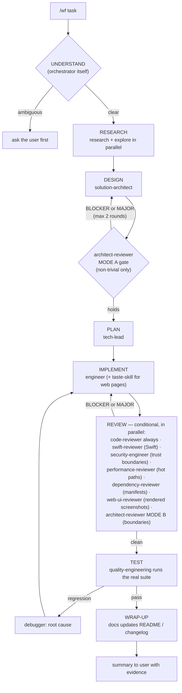
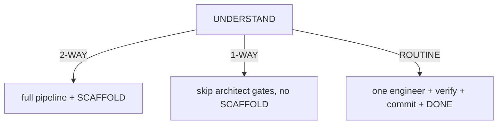

# OpenCode V2 Multi-Agent Workflow Setup

How to configure **OpenCode V2** (the coding agent at `opencode.ai` — a different
product from Claude Code) so a fleet of specialist subagents runs a full
research → dev → test pipeline under one primary orchestrator, with sync-time
permission hardening. Like `orchestrator-only-setup.md`, this is a
personal-machine configuration (not part of this repo's `install.sh`); it
exists so it can be replicated on another machine or audited later.

Config lives in `~/.config/opencode/`. Everything below was verified against a
running V2 service via its HTTP API on 2026-10-16.

---

## 1. What this setup does

OpenCode V2 has no built-in pipeline engine. Orchestration is a pattern, not a
feature: one `primary`-mode agent (the orchestrator) dispatches stages to
`subagent`-mode specialists through the `subagent` tool, and each stage hands
off to the next through **files on disk**, because every subagent starts with
fresh context and sees nothing from the parent session.

The machine already had 19 specialist subagents (synced from Claude Code
definitions — see §5), so the additions were:

1. A `orchestrator` Markdown agent that encodes the pipeline, bounded loops,
   concurrency rules, Work-Board integration, and hard rules (never push/PR
   without the user, real exit codes or it didn't happen).
2. Three slash commands (`/wf`, `/wf-status`, `/wf-list`) as deterministic
   entry points.
3. A hardening section in the sync script so every synced subagent gets
   least-privilege permissions for skills and MCP tools — enforced by the
   engine, not by prompts.
4. Five new/repurposed specialists since the first cut: `engineer` (IMPLEMENT
   stage, pulled out of the sync SKIP list), `performance-reviewer`,
   `dependency-reviewer`, `web-ui-reviewer` (visual/UX, needs a
   vision-capable model), and `architect-reviewer` (independent design and
   boundary critique) — the roster is now 24 synced workers.

## 2. The pipeline



Loop caps: max 3 review cycles, max 3 debug cycles; NITs batch at the end.
Hitting a cap stops the run and reports options instead of looping silently.

Every stage writes its artifact to `docs/workflow/<slug>/` (`research.md`,
`design.md`, `plan.md`, `log.md`). The file is the handoff — the next stage's
subagent reads it from disk, which also gives the user an audit trail.
`/wf-status` reads the newest run's `log.md`.

## 3. Orchestration mechanics (OpenCode V2)

| Mechanism | How it is used here |
| --- | --- |
| Agent modes | Workers are `mode: subagent`; only `orchestrator` is `primary`. The session's default agent stays `build`, so ordinary chats are unaffected — `/wf` is the only way in. |
| `subagent` permission | Orchestrator sets `deny subagent *` first, then `allow` for its 16 workers (last matching rule wins). The orchestrator physically cannot dispatch to anything else. Flat hierarchy: synced workers all carry `deny subagent *`, so none of them spawns grandchildren. |
| Routing | The parent model picks workers by their `description` text. Descriptions are written as "Use when …" triggers. |
| Context isolation | Each dispatch prompt must carry the task + paths of prior artifacts; results come back as summaries only. This is why artifacts live on disk. |
| Commands | `commands/wf.md` sets `agent: orchestrator`, so `/wf` switches the session to the orchestrator before submitting the prompt. |

## 4. Where the files live

```text
~/.config/opencode/
├── opencode.json                  # agents map — REGENERATED by sync-from-claude.py, do not hand-edit
├── agents/orchestrator.md         # Markdown agent: frontmatter = config, body = system prompt; repo mirror at ~/Work/my-superpowers/agents/orchestrator.md
├── commands/wf.md                 # /wf — entry point (agent: orchestrator)
├── commands/wf-status.md          # /wf-status (optional run slug)
├── commands/wf-list.md            # /wf-list — every run with status/staleness
├── sync-from-claude.py            # mirrors ~/.claude/agents/*.md into opencode.json + appends hardening
└── opencode.json.pre-*            # dated backups taken before each hardening run
```

`orchestrator.md` frontmatter carries `mode`, `color`, and the subagent
allowlist; the Markdown body is the system prompt (stage order, caps, hard
rules, "reply to the user in Thai"). OpenCode merges agent definitions from
all sources; the `.md` files are not touched by the sync script, which only
rewrites the `agents` key of `opencode.json` — that separation is what keeps
the workflow survivable across re-syncs.

## 5. Sync-time permission hardening

`sync-from-claude.py` mirrors `~/.claude/agents/*.md` (Claude Code frontmatter
+ prompt) into OpenCode's `agents` map, converting a Claude `tools:` allowlist
into deny rules for unlisted edit/shell/web/read tools. Because the script
rewrites the whole `agents` key on every run, per-agent permissions must live
in the script itself — a `hardening(name)` function appends deny rules after
the generic ones. Permissions are ordered rules where the **last match wins**,
so appended denies refine (or override) the generic baseline.

The hardening mapping, and the reasoning behind each line:

| Rule | Applied to | Why |
| --- | --- | --- |
| deny `my-memory_*` | all 19 | Subagents digest untrusted web/file content; a memory-write MCP is a persistent indirect-prompt-injection channel. Memory writes belong to interactive/orchestrator sessions. |
| deny `drawdy_*`, `figcraft*` | all 19 | Whiteboard/design MCP servers are in nobody's job description here. |
| deny `XcodeBuildMCP_*` | 16 analysis/review/planning agents | No device/build actions from read-only roles. |
| keep `XcodeBuildMCP` | `debugger` (logs/LLDB), `quality-engineering` (runs the test suite), `devops-engineer` (build automation) | These three need device/build access; denying would break the pipeline's TEST stage. |
| deny `skill` | `api-designer`, `wiki-updater`, `performance-reviewer`, `dependency-reviewer` | Only agents whose prompts never load skills. Removed from this list as prompts gained skill references: swift-reviewer (domain skills), then tech-lead / docs / research / ui-reviewer (skill-gap pass), then engineer (taste-skill). `code-reviewer` (uses `scrutinize`), `debugger` (uses `diagnose` + `test-verdict-triage`) and the qa/security/architect/sre/data/ai group keep skill access — check the agent's prompt before denying. |
| **keep** `edit` + `shell` + `XcodeBuildMCP` for `engineer` | `engineer` (joined 2026-10-17 as the IMPLEMENT stage) | The implementation specialist needs full file/shell/build access. Its prompt enforces scope-freeze, real verification, **it never commits**, and loads `taste-skill` for public-facing web pages. |
| deny `edit` + `shell` | `code-reviewer`, `swift-reviewer`, `ui-reviewer`, `performance-reviewer`, `dependency-reviewer`, `web-ui-reviewer`, `architect-reviewer` | Reviewers report findings; the implementer applies fixes. Their Claude-side definitions had no `tools:` line (all tools), so this pins them read-only at the engine level. |
| deny `shell` (keep `edit`) | `wiki-updater` | It writes vault files by design but never runs commands. |
| allow `edit` on `**/docs/workflow/*` only | `research`, `solution-architect`, `tech-lead` | The artifact stages must write their handoff files (`research.md`, `design.md`, `plan.md`) but nothing else. Appended after the generic edit denies — last matching rule wins, so the scoped allow beats `deny edit *` for that path only. Change the constant `WORKFLOW_DIR` in `sync-from-claude.py` if the pattern ever needs to move. |

### Skill wiring (2026-10-17)

A skill is only loadable when (a) the agent's prompt names it and (b) the agent
is not in `SKILL_DENY`. Current wiring, beyond each agent's own domain checks:

| Agent | Skills it loads |
| --- | --- |
| `orchestrator` | `verified-change-loop` (stage handoffs), `test-verdict-triage` (TEST stage) |
| `engineer` | `taste-skill` for public-facing web pages (gates: `lint.mjs` + `inspect.mjs`) |
| `debugger` | `diagnose`, `test-verdict-triage` |
| `quality-engineering` | `ci-quality-gates`, `ai-agent-security`, `reporting-test-results`, `test-verdict-triage` |
| `tech-lead` | `writing-plans`, `verified-change-loop` |
| `docs` | `engineering-documentation`, `changelog-writer`, `writing-release-notes` |
| `research` | `research-verify`, `jev-workflow` |
| `ui-reviewer` | `liquid-glass`, `ios-accessibility`, `ios-localization` |
| `solution-architect` | `designing-systems`, `authoring-adrs`, `architecture-tradeoff-toolkit`, `data-system-design-heuristics`, `domain-boundary-design`, `codebase-design`, `neuroarxiv` |
| `swift-reviewer` | 6 Apple domain skills (HealthKit, WatchConnectivity, WidgetKit, Vision, IOKit, on-device LLM) |
| `ai-engineer` | + `prompt-engineering-patterns` |
| `web-ui-reviewer` | `taste-skill` (critique rubric), `design-critique`, `web-design-guidelines` |
| `architect-reviewer` | `architecture-description-review`, `richards-ford-software-architecture`, `ousterhout-software-design`, `martin-clean-architecture`, `architecture-tradeoff-toolkit`, `codebase-design`, `domain-boundary-design` |
| still denied | `api-designer`, `wiki-updater`, `performance-reviewer`, `dependency-reviewer` |

### Third-party skill installation

Third-party skills go through the repo, not a direct installer: scan SKILL.md +
every script for network calls, `eval`/`exec`, credential access, and
AI-directed instructions (independent subagent scan), check license and
repo health via the GitHub API, clone and pin the commit, copy only the skill
actually needed into `skills/<category>/<name>/`, record it in
`ATTRIBUTION.md` with the pinned SHA, then `./install.sh --force --skill <id>`.
First entry: `taste-skill` (Leonxlnx/taste-skill, MIT, pinned `f624f37a`,
2026-10-17) — scripts contact only disclosed image-archive endpoints;
see its ATTRIBUTION section for the scan summary.

Two lessons from applying this:

- **Read the agent's prompt before denying a tool.** Two agents that looked
  safely deniable actually depended on a skill by name. Grep the synced
  `.md` bodies for `skill`/tool references first.
- **deny of `edit`/`shell` does not imply MCP is denied.** The synced
  read-only reviewers could still build, run, and erase simulators through
  MCP until `XcodeBuildMCP_*` was explicitly denied — tool-category denies and
  MCP denies are independent rule sets.

## 6. Verifying the setup

The background service exposes the live merged config:

```sh
opencode api get /api/agent     # agents, modes, effective permissions
opencode api get /api/command   # slash commands
```

Assert against this, not against the files: for each synced agent, the four
MCP denies exist; `XcodeBuildMCP_*` is denied exactly on the 20-list and
absent for `debugger`/`quality-engineering`/`devops-engineer`/`engineer`;
`skill` denied exactly on the 4-list; reviewers carry `edit`+`shell` denies;
the artifact stages carry the scoped `**/docs/workflow/*` allow (the 20/4/16
counts are unchanged; only the pattern text changed); `wiki-updater` denies
`shell` but not `edit`; `orchestrator` is `mode: primary` with 16 subagent
allows. Built-ins (`build`, `plan`, `general`, `explore`, and the hidden
maintenance agents) appear with capitalized display names but lowercase ids
— the orchestrator's allowlist uses the lowercase ids.

Re-run these assertions every time `sync-from-claude.py` is changed or the
agent prompts are edited: `python3 ~/.config/opencode/sync-from-claude.py`,
then `opencode api get /api/agent` and confirm the three artifact agents show
`edit` allowed on `**/docs/workflow/*` and `orchestrator` still shows 16
subagent allows.

Tip learned the hard way: when probing permissions from the API, match BOTH
the action and the resource as wildcard patterns (`*` crosses `/`) — the
MCP deny rules use pattern actions like `my-memory_*`, and a literal
comparison reports them as allowed when the engine would deny.

## 7. Replicating on another machine

1. Install OpenCode V2 and sign in to a provider (`/connect`).
2. Configure the MCP servers you actually have under `mcp.servers`; the
   hardening denies are harmless if a named server is absent.
3. Copy `sync-from-claude.py` (or just its `hardening()` section into your own
   mirror script) and run it: `python3 ~/.config/opencode/sync-from-claude.py`.
4. Copy `agents/orchestrator.md`, `commands/wf.md`, `commands/wf-status.md`,
   `commands/wf-list.md` from this machine (or from the vault snapshot of
   this doc's date).
5. Back up `opencode.json` before the first run; run the verification in §6.

## 8. Known gaps and follow-ups

- Built-in agents (`build`, `plan`, `general`, `explore`) have default
  permissions — `general` stays available to the orchestrator for non-plan
  odd jobs and can use every MCP server. Acceptable for a single-user
  machine; not for shared ones.
- `quality-engineering` has `shell` denied by its Claude-side `tools:` line,
  so its only path to running a suite is `XcodeBuildMCP` — iOS projects work
  end to end; for non-iOS suites the orchestrator must run tests itself.
- Workflow prompts still need a real-task shakedown; expect to tune stage
  wording after the first run or two (~5 min per iteration).
- The stage prompts embed personal conventions (never push/PR without the
  user, Thai replies). Adjust before handing this to another person.
- Per-agent model pinning is designed and researched but not implemented
  (waiting on exact `provider/model` ids from `/models`): planned pins are
  `engineer` → Kimi K2.7 Code, `orchestrator` → GPT 6 Luna,
  `web-ui-reviewer` → a vision-capable model (DeepSeek V4.1 Flash / Kimi K3 /
  Qwen3.8 Max), `architect-reviewer` → a strong reasoning model. Pin via a
  MODEL map in the sync script so re-syncs keep it.
- Notion free tier: Query Data Source has a rolling quota and comment
  deletion needs Business. The board still works for create/update/comment;
  for bulk reads, wait for the quota or fetch pages directly.

## 9. Running multiple workflows in parallel

File separation is per-run by design (`docs/workflow/<slug>/`), but concurrent
runs need explicit rules on top — otherwise two pipelines edit the same tree,
interleave their stage state, and collide on slugs.

Mechanics added 2026-10-16:

- **Terminal markers.** A run's `log.md` ends with a `DONE: <date> — <outcome>`
  line when finished, or `PARKED: <date> — <reason>` when parked. A run is
  ACTIVE while its `log.md` has neither. Status is one grep away.
- **One pipeline per session.** Interleaving two runs in one orchestrator
  session tangles stage state; a second task goes to a second session.
- **Collision policy.** Starting a task while another run is ACTIVE: the
  orchestrator offers queue / separate git worktree (`../<repo>-wf-<slug>`,
  branch `wf/<slug>` — matching the new-branch hard rule) / park the active
  run (`PARKED:` line) and start fresh. Existing slug → resume or `<slug>-2`,
  never overwrite.
- **Commands.** `/wf` asks the collision question; `/wf-status <slug>` takes
  an optional run slug; `/wf-list` reports every run with status and staleness.

```mermaid
flowchart TD
    W["/wf task B"] --> C{"มี run ACTIVE อยู่ไหม"}
    C -->|"ไม่มี"| S["เริ่ม run ใหม่ตาม pipeline"]
    C -->|"มี"| A{"ผู้ใช้เลือก"}
    A -->|"queue"| Q["รอ run ปัจจุบันจบ แล้วเริ่ม"]
    A -->|"worktree"| WT["git worktree add -b wf/&#60;slug&#62;<br/>รัน pipeline ใน tree แยก"]
    A -->|"park"| P["append PARKED: ลง log.md<br/>แล้วเริ่ม run ใหม่"]
    S --> D["จบ run: append DONE:"]
    WT --> D
    Q --> D
    P2["PARKED run"] -->|"resume /wf"| R["อ่าน log.md<br/>continue จาก stage ล่าสุด"]
```



Merge policy across parallel runs stays manual and serial: each run lands on
its own branch; the user merges one at a time so REVIEW/TEST evidence maps to
one diff at a time.

## 10. Run mechanics (P0, 2026-10-17)

Five upgrades from a four-notebook research pass (AI-Native SDLC, Shopify AI
workflow, PR bottleneck, agent harnesses):

- **`learnings.md` forced-read.** Every run folder carries a `learnings.md`
  seeded from the cross-run `docs/workflow/learnings.md`; every dispatch
  prompt opens with "read it first". WRAP-UP appends new lessons to both.
- **Contract-first IMPLEMENT.** Each behavioral task starts with its failing
  test run to the right failure before feature code; the test ships with the
  change (orchestrator prompt + `engineer` prompt).
- **Risk-door triage.** At UNDERSTAND the change is classified 1-way door
  (routine, reversible — skips `architect-reviewer`, light REVIEW) or 2-way
  door (auth/payments/migration/schema/interface/boundary — full gates).
  Recorded in `log.md`.
- **Playwright interaction review.** The `playwright` MCP server (local,
  `npx @playwright/mcp@latest`) is scoped to `engineer`, `web-ui-reviewer`,
  `debugger`, `quality-engineering`, `devops-engineer`; everyone else gets
  `playwright_*` denied. `web-ui-reviewer` drives the page (CTA, form,
  error path) instead of judging static screenshots alone; `engineer`
  verifies rendered behavior with it.
- **Retro hook.** WRAP-UP posts durable lessons to memory (`my-memory`,
  layer `lesson`) and the cross-run `learnings.md` — the factory learns per
  run, not per week.

## 11. Run mechanics (P1, 2026-10-17)

Six prompt/config upgrades that shipped with this doc:

- **3 lanes.** UNDERSTAND classifies **2-WAY**, **1-WAY**, or **ROUTINE**.
  2-WAY runs the full pipeline plus SCAFFOLD; 1-WAY skips the
  `architect-reviewer` gates and SCAFFOLD; ROUTINE is one `engineer` dispatch
  plus verification, commit, and `DONE`, with promotion upward only.
- **Blind dispatch.** Reviewers never see the engineer's per-file report or
  each other's findings; a re-review round gets only that reviewer's own prior
  findings verbatim.
- **SCAFFOLD stage.** The orchestrator runs Task 0 from `plan.md` (install
  command, baseline sanity, test-suite command) before IMPLEMENT on 2-WAY runs;
  Work Board Owner = `opencode` during this step.
- **Commit-on-stop backstop.** The orchestrator is the only committer;
  per-stage boundary commits on the run branch, never push, no self-squash.
- **Mermaid diff summary.** WRAP-UP dispatches `docs` to produce
  `docs/workflow/<slug>/diff-summary.md`; the orchestrator quotes it verbatim.
- **Nested-root-safe allow pattern.** The scoped allow for artifact agents
  moved from `docs/workflow/*` to `**/docs/workflow/*` via the `WORKFLOW_DIR`
  constant in `sync-from-claude.py`.



### Fitness functions (P1)

After every sync and prompt edit, run these greps against both the installed
prompts and the repo mirrors. They catch unblinding or mirror divergence that
would otherwise pass silently:

```sh
grep -c "If asked to commit" agents/engineer.md                            # → 0
grep -c "If asked to commit" ~/.claude/agents/engineer.md                  # → 0
grep -c "Blind dispatch" agents/orchestrator.md                            # → ≥ 1
grep -c "ROUTINE" agents/orchestrator.md                                   # → ≥ 3
grep -c "SCAFFOLD" agents/orchestrator.md                                  # → ≥ 2
grep -c "Inputs you receive" agents/web-ui-reviewer.md                     # → ≥ 1
grep -c "Inputs you receive" agents/architect-reviewer.md                  # → ≥ 1
```

Then run `python3 tools/agent-evals/scripts/doctor.py --repo .` and expect
**0 errors**, and `diff` every installed agent against its repo mirror.

## 12. Model pins (OpenCode Go Plus, 2026-10-17)

Per-agent model pins live in the sync script's `MODEL` map — chosen from the
2026-10-17 model research (benchmarks + Go Plus rate limits) so each stage runs
on the model whose strengths match its job, with Go Plus monthly limits as the
ceiling. Unlisted agents inherit the session model. The orchestrator pins its
own model in its Markdown frontmatter (`opencode-go/gpt-6-luna`).

| Agent | Model | Go Plus /5h | Rationale |
| --- | --- | --- | --- |
| `orchestrator` | `gpt-6-luna` | 16,920 | judgment + coordination volume |
| `research`, `docs` | `deepseek-v4.1-flash` | 69,330 | strongest volume-tier model (DeepSWE 74.2) — research quality feeds design; ⚠️ **requires workspace Privacy = Global** |
| `wiki-updater` | `mimo-v2.6-flash` | 60,200 | mechanical vault updates — region-safe |
| `solution-architect`, `architect-reviewer` | `qwen3.8-max` | 640 | SWE-bench Pro 67.7% — best quality, few calls |
| `tech-lead` | `glm-5.2` | 2,640 | planning strength at $60/mo |
| `engineer` | `kimi-k2.7-code` | 4,050 | purpose-built agentic coder, −30% thinking tokens |
| 5 reviewers + `web-ui-reviewer` | `claude-haiku-5-5` | 15,380 | judgment at haiku price, vision-capable |
| `quality-engineering` | `glm-5.3-flash` | 18,960 | TB2.1 84.3 — high-volume test runs |
| `debugger` | `glm-5.3` | 1,760 | TB3.0 open-weight lead — long-horizon root cause |
| ROUTINE lane | engineer's pin | — | the lane rides the IMPLEMENT model |

Notes: `#variant` effort suffixes are NOT usable today — none of the Go models
expose catalog variants (verified against the Go models endpoint and
models.dev); define custom variants per model in config if effort control
becomes necessary. ZDR note: GLM/Kimi/DeepSeek/MiMo/Qwen/LongCat models retain
0 days; Haiku 5.5 retains 30 days; Gemini 4 Argon and Muse Spark train on
prompts (not pinned anywhere). The Go roster rotates — re-verify quarterly
(**including region requirements**: `deepseek-v4.1-flash` serves only from
Global regions — if its pin errors with "requires Global regions", either
re-select Global in the Console workspace Privacy settings or re-pin
`research`/`docs` to `mimo-v2.6-flash`/`longcat-2.0`). Cheap probe:
`opencode run --model opencode-go/deepseek-v4.1-flash "OK"` — nonzero exit
means the region setting moved.
Unpinned (inherit session model): `sre`, `data-engineer`, `ai-engineer`,
`api-designer`, `devops-engineer`, `qa-*`, `explore`, `general`.
