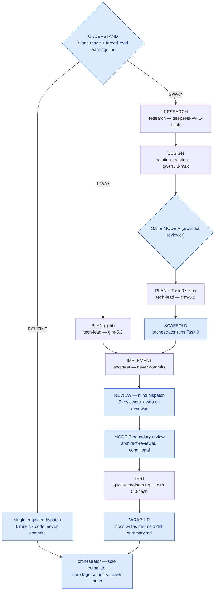

# diff-summary — P1 factory upgrades (2026-10-17)

- **4 new review agents:** `performance-reviewer`, `dependency-reviewer`, `web-ui-reviewer`, and `architect-reviewer` (two modes — MODE A design gate, MODE B boundary review of diffs).
- **`engineer` owns the IMPLEMENT stage and never commits.** The orchestrator is the sole committer: per-stage commits on the run branch, never push.
- **Per-agent model pins (OpenCode Go Plus):** orchestrator `gpt-6-luna`; `research` + `docs` `deepseek-v4.1-flash`; `solution-architect` + `architect-reviewer` `qwen3.8-max`; `tech-lead` `glm-5.2`; the 5 reviewers + `web-ui-reviewer` `claude-haiku-5-5`; `quality-engineering` `glm-5.3-flash`; `debugger` `glm-5.3`; `wiki-updater` `mimo-v2.6-flash`.
- **Skills wired to owners:** `taste-skill` to `engineer`; `test-verdict-triage` to `debugger` + `quality-engineering`; `verified-change-loop` to `tech-lead` + orchestrator; the `engineering-documentation` set to `docs`; `research-verify` + Jev to `research`; Apple domain skills to `swift-reviewer`; `neuroarxiv` to `solution-architect`.
- **Run mechanics:** 3 lanes (2-WAY full pipeline, 1-WAY light, ROUTINE single dispatch), forced-read `learnings.md`, SCAFFOLD baseline, blind reviewer dispatch, commit-on-stop backstop, `docs`-authored mermaid diff summary, and the nested-root-safe allow pattern `**/docs/workflow/*`.

