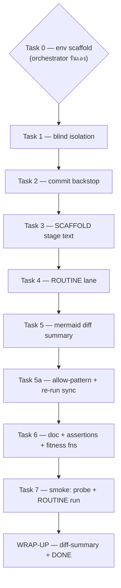

# plan.md — P1 factory upgrades (PLAN stage, 2026-10-17)

Design ที่ผ่าน gate แล้ว: `design.md` (round 3 ปิดครบ) · ลำดับตาม design §10 —
(0) baseline mirror **เสร็จแล้ว (7e57443) ข้าม** → (1) blind isolation → (2) commit backstop
→ (3) SCAFFOLD → (4) ROUTINE lane → (5) mermaid summary → (5a) allow-pattern + re-run
→ (6) doc + doctor + re-assertions → (7) smoke · ปิดด้วย WRAP-UP ของ run นี้เอง



Tasks 1–6 **ทำตามลำดับเท่านั้น ห้ามขนาน** — ทุก task แตะ `orchestrator.md` ร่วมกัน
(merge-conflict แน่นอนถ้าขนาน) และ Task 5a ต้อง re-run sync หลัง prompt edits ทั้งหมด
mirror แล้วเท่านั้น (sync regenerates `agents` key ทั้งก้อน — rule ของ run)

## กติกาคงที่ทุก task (global invariants)

- **สองสำเนาต้องเท่ากันเสมอ**: ไฟล์ prompt ทุกไฟล์มี installed copy + repo mirror
  - Claude agents: `~/.claude/agents/<name>.md` ↔ `~/Work/my-superpowers/agents/<name>.md`
  - orchestrator (OpenCode-native): `~/.config/opencode/agents/orchestrator.md`
    ↔ `~/Work/my-superpowers/agents/orchestrator.md` (baseline 7e57443)
  - sync script: `~/.config/opencode/sync-from-claude.py` (live) ↔
    `~/Work/my-superpowers/tools/mirror/sync-from-claude.py` (canonical baseline)
  - แก้ **ฝั่งเดียว** แล้ว `diff <installed> <mirror>` → ต้อง **ว่าง (exit 0)** ก่อนไปต่อ;
    ถ้าไฟล์เป็น real copy (ไม่ใช่ symlink) ให้ cp ฝั่งที่แก้ทับอีกฝั่ง
- **doctor.py ก่อน commit ทุกครั้ง** (ERROR = blocking): `python3 tools/agent-evals/scripts/doctor.py --repo .`
  → expected: exit 0, **0 errors, 27 agents**
- **Commit ปลายทางทุก task** (dogfood ข้อ §5 ตั้งแต่ task แรก): บน branch ของ run,
  never push, message `wf(p1-factory-upgrades): TASK <n> — <evidence 1 บรรทัด>` ·
  จด hash ลง `log.md` เป็น rollback point
- **ห้ามแตะ**: `README.md`, `ATTRIBUTION.md`, repo `AGENTS.md` (design §8 item 13)
- ก่อน edit ไฟล์ prompt ทุกครั้ง: grep หา text จริงในไฟล์ก่อน (learnings ข้อ 1)

---

## Task 0 — env scaffold *(orchestrator รันเอง — SCAFFOLD decision §1)*

**Install command: ไม่มี** — ทั้ง run เป็น prompt/config-only

**Baseline sanity commands + expected results** (รันจาก `~/Work/my-superpowers`):

| # | Command | Expected |
| --- | --- | --- |
| 0.1 | `git branch --show-current` | เป็น run branch (`wf/p1-factory-upgrades` หรือเทียบเท่า) — ถ้ายังอยู่ default branch ให้สร้าง branch ใหม่ก่อน (branch-always) · `git log --oneline -1 7e57443` ต้องไม่ error |
| 0.2 | `python3 tools/agent-evals/scripts/doctor.py --repo .` | exit 0 — **0 errors, 27 agents** |
| 0.3 | sync idempotency: `cp ~/.config/opencode/opencode.json "$TMPDIR/opencode.json.bak-p1"` แล้ว `python3 ~/.config/opencode/sync-from-claude.py` | stdout: `agents written: 24; skipped: ['haiku-engineer', 'qa-execution-operator']` · แล้ว `diff "$TMPDIR/opencode.json.bak-p1" ~/.config/opencode/opencode.json` → **ว่าง (exit 0)** = baseline idempotent · ถ้า diff ไม่ว่าง → **STOP** รายงาน drift ก่อน |
| 0.4 | `opencode api get /api/agent` | 24 subagents + `orchestrator` mode `primary` มี **16** subagent allows |
| 0.5 | `diff ~/.config/opencode/agents/orchestrator.md agents/orchestrator.md` | ว่าง — mirror ตรง 7e57443 |

**Evidence:** บรรทัด `SCAFFOLD` ลง `log.md` พร้อม exit codes จริง · **Work Board:** owner = `opencode` · **Dependencies:** ไม่มี — ต้องผ่านครบก่อน dispatch ใด ๆ

---

## Task 1 — Blind reviewer isolation (design §2)

**Goal:** engineer's per-file report ไม่ถูก materialize และไม่ forward; reviewers ไม่เห็น findings ข้ามกัน; re-review เห็นเฉพาะ prior findings ของตัวเอง verbatim

| File | การแก้ |
| --- | --- |
| `agents/orchestrator.md` (repo) + installed | ย่อหน้า **Blind dispatch** ใน stage REVIEW |
| `agents/web-ui-reviewer.md` + installed | input pins ยึด template **"Inputs you receive"** |
| `agents/architect-reviewer.md` + installed | input pins: MODE A = design.md เท่านั้น / MODE B = design.md + plan.md + changed files — semantics MODE A/B คงเดิม |

**Verification:**

```sh
diff ~/.config/opencode/agents/orchestrator.md agents/orchestrator.md            # → ว่าง
diff ~/.claude/agents/web-ui-reviewer.md agents/web-ui-reviewer.md               # → ว่าง
diff ~/.claude/agents/architect-reviewer.md agents/architect-reviewer.md         # → ว่าง
grep -c "Blind dispatch" agents/orchestrator.md                                  # → ≥ 1
grep -c "Inputs you receive" agents/web-ui-reviewer.md                           # → ≥ 1
grep -c "Inputs you receive" agents/architect-reviewer.md                        # → ≥ 1
grep -c "MODE A" agents/architect-reviewer.md                                    # → ≥ 1
python3 tools/agent-evals/scripts/doctor.py --repo .                             # → 0 errors
```

**Dependencies:** Task 0 · **ขนาด:** ~30–40 นาที · commit `wf(p1-factory-upgrades): TASK 1 — blind dispatch + input pins, doctor 0 err`

---

## Task 2 — Commit-on-stop backstop (design §5)

**Goal:** orchestrator เป็น committer เดียว — commit ต่อ stage boundary, branch ของ run, never push, `wf(<slug>): <STAGE> — <evidence>`, log.md จด hash, cap-stop/PARKED commit สถานะสุดท้าย, ห้าม squash/amend เอง

| File | การแก้ |
| --- | --- |
| `agents/orchestrator.md` + installed | section ใหม่ **ก่อน Hard rules** |
| `agents/engineer.md` + installed | rewrite `"If asked to commit: …"` → **never-commit** |

**Verification:**

```sh
diff ~/.claude/agents/engineer.md agents/engineer.md                             # → ว่าง
grep -c "If asked to commit" agents/engineer.md                                  # → 0 (fitness fn §8.15)
grep -c "never commit" agents/engineer.md                                        # → ≥ 1
grep -c "wf(" agents/orchestrator.md                                             # → ≥ 1
python3 tools/agent-evals/scripts/doctor.py --repo .                             # → 0 errors
```

**Deviation note:** design §5 ระบุ "sync SKIP comment" เป็นไฟล์ของ task นี้ — ย้ายไปรวมกับ Task 5a (sync re-run ครั้งเดียวหลัง mirror ครบ) ตรงกับ design §8 item 7 bundle เอง

**Dependencies:** Task 1 · **ขนาด:** ~30 นาที

---

## Task 3 — SCAFFOLD stage text (design §1)

**Goal:** stage SCAFFOLD ระหว่าง PLAN–IMPLEMENT (stage ใหม่ = 5, เลขเดิม 5–8 → 6–9) + PLAN requirement (Task 0 sizing) + ใช้เฉพาะ 2-WAY · owner ช่วง SCAFFOLD = `opencode` · ไม่เพิ่ม ARTIFACT_WRITERS/allowlist

**Files:** `agents/orchestrator.md` + installed (ไฟล์เดียว)

**Verification:**

```sh
grep -c "SCAFFOLD" agents/orchestrator.md                                        # → ≥ 2
grep -n "^### .*[0-9]" agents/orchestrator.md | head -20                         # → เลข stage 5–9 ไม่ซ้ำ ไม่ข้าม
grep -c "Task 0" agents/orchestrator.md                                          # → ≥ 1
python3 tools/agent-evals/scripts/doctor.py --repo .                             # → 0 errors
```

**Dependencies:** Task 2 · **ขนาด:** ~30 นาที

---

## Task 4 — ROUTINE lane (design §3)

**Goal:** 3 lanes ใน UNDERSTAND + Hard rules rewrite (2-WAY / 1-WAY / ROUTINE + never-skip list + ประโยคปิดช่อง `general` + promote-up only never down)

**Files:** `agents/orchestrator.md` + installed (ไฟล์เดียว)

**Verification:**

```sh
grep -c "ROUTINE" agents/orchestrator.md                                         # → ≥ 3
grep -c "promote" agents/orchestrator.md                                         # → ≥ 1
python3 tools/agent-evals/scripts/doctor.py --repo .                             # → 0 errors
```

**Dependencies:** Task 3 · **ขนาด:** ~40 นาที

---

## Task 5 — Mermaid diff summary (design §4)

**Goal:** docs subagent ผลิต `docs/workflow/<slug>/diff-summary.md` เสมอใน 1-WAY/2-WAY (ROUTINE ข้าม) — orchestrator quote verbatim เท่านั้น

| File | การแก้ |
| --- | --- |
| `agents/orchestrator.md` + installed | WRAP-UP: docs dispatch ผลิต diff-summary.md + quote verbatim |
| `agents/docs.md` + installed | bullet **mermaid convention**: quote ป้ายที่มีวงเล็บ · `&#60;/&#62;` แทน `<>` · ห้าม `/` เปล่าใน edge labels |

**Verification:**

```sh
diff ~/.claude/agents/docs.md agents/docs.md                                     # → ว่าง
grep -c "diff-summary" agents/orchestrator.md                                    # → ≥ 1
grep -ci "mermaid" agents/docs.md                                                # → ≥ 1
python3 tools/agent-evals/scripts/doctor.py --repo .                             # → 0 errors
```

**Dependencies:** Task 4 · **ขนาด:** ~25 นาที

---

## Task 5a — Allow-pattern expansion + re-run sync (design §4a, §8 items 6–7)

**Goal:** `docs/workflow/*` → `**/docs/workflow/*` แก้ที่ค่าคงที่จุดเดียวของ sync script — prompt ของ 3 artifact agents และ mirrors **ไม่แก้** + เติม SKIP comment ให้ตรง engineer never-commit

| File | การแก้ |
| --- | --- |
| `~/.config/opencode/sync-from-claude.py` (live) | `WORKFLOW_DIR = "docs/workflow/*"` → `"**/docs/workflow/*"` · line 13 comment เติม never-commit note |
| `tools/mirror/sync-from-claude.py` (canonical) | แก้ 2 บรรทัดเดียวกัน |

**Verification (ลำดับสำคัญ — ต้องหลัง Task 5):**

```sh
diff ~/.config/opencode/sync-from-claude.py tools/mirror/sync-from-claude.py     # → ว่าง
cp ~/.config/opencode/opencode.json "$TMPDIR/opencode.json.pre-5a"
python3 ~/.config/opencode/sync-from-claude.py
# → "agents written: 24; skipped: ['haiku-engineer', 'qa-execution-operator']"
diff "$TMPDIR/opencode.json.pre-5a" ~/.config/opencode/opencode.json
# → ต่างเฉพาะ permission rows ของ research / solution-architect / tech-lead
grep -c '\*\*/docs/workflow/\*' ~/.config/opencode/opencode.json                 # → 3
grep -c '"engineer"' ~/.config/opencode/opencode.json                            # → 1
opencode api get /api/agent
# → 24 subagents + orchestrator primary · 3 artifact agents มี allow **/docs/workflow/* · 16 allows
```

**Dependencies:** Task 5 · **ขนาด:** ~20 นาที · nested-root write probe พิสูจน์ใน Task 7

---

## Task 6 — Doc + doctor + re-assertions + fitness functions (design §8 items 8–15)

**File:** `docs/opencode-workflow-setup.md` (repo — ไฟล์เดียว)

| Section | การแก้ (item) |
| --- | --- |
| §2 The pipeline | แก้ edge label `BLOCKER / MAJOR` 2 จุด ไม่ให้มี `/` เปล่า (item 8) |
| §4 Where the files live | เพิ่ม row `agents/orchestrator.md` + ระบุ repo mirror (item 9) |
| §5 Sync-time permission hardening | row engineer: `"safe commits"` → `"it never commits"` · row artifact stages: pattern → `**/docs/workflow/*` + note แก้ที่ `WORKFLOW_DIR` จุดเดียว (item 10) |
| §6 Verifying the setup | wording pattern → `**/docs/workflow/*` — จำนวน **20/4/16 ไม่แก้** + **re-run assertions จริง** (item 11) |
| §11 (ใหม่) Run mechanics (P1, 2026-10-17) | ต่อจาก §10: 3 lanes (mermaid เล็ก), blind dispatch, SCAFFOLD, commit-on-stop, diff-summary, allow-pattern expansion + **fitness functions** (item 12 + 15) |

**Fitness functions (grep-based — รันกับ installed และ mirrors ทั้งคู่, item 15):**

```sh
grep -c "If asked to commit" agents/engineer.md                            # → 0
grep -c "If asked to commit" ~/.claude/agents/engineer.md                  # → 0
grep -c "Blind dispatch" agents/orchestrator.md                            # → ≥ 1
grep -c "ROUTINE" agents/orchestrator.md                                   # → ≥ 3
grep -c "SCAFFOLD" agents/orchestrator.md                                  # → ≥ 2
grep -c "Inputs you receive" agents/web-ui-reviewer.md                     # → ≥ 1
grep -c "Inputs you receive" agents/architect-reviewer.md                  # → ≥ 1
```

**Mirror-parity check (item 15 — gate round 2):**

```sh
for f in ~/.claude/agents/*.md; do diff "$f" "agents/$(basename "$f")" || echo "DIVERGED: $f"; done
# → ไม่มี DIVERGED, exit 0 · set คาดหมาย: 26 ไฟล์ + orchestrator.md
diff ~/.config/opencode/agents/orchestrator.md agents/orchestrator.md      # → ว่าง
diff ~/.config/opencode/sync-from-claude.py tools/mirror/sync-from-claude.py  # → ว่าง
```

จากนั้น re-run §6 assertions เต็มรูป (`opencode api get /api/agent` + permission probes match wildcard ทั้ง action และ resource) — expected: true ทุกข้อ ยกเว้น pattern text · ปิดท้าย `python3 tools/agent-evals/scripts/doctor.py --repo .` → **0 errors** ก่อน commit

**Dependencies:** Task 5a · **ขนาด:** ~45–60 นาที

---

## Task 7 — Smoke: nested-root probe + ROUTINE real run (design §4a, §8 items 6/15/16)

**(a) Nested-root write probe — ห้ามข้าม (FINDING ของ run นี้):**

จาก session cwd ที่ซ้อนใต้ project root (`~/Work`, project `~/Work/my-superpowers`) — dispatch **3 artifact agents** (`research`, `solution-architect`, `tech-lead`) ด้วย brief: เขียน scratch file `docs/workflow/p1-factory-upgrades/probe/<agent>.md` หนึ่งบรรทัด รายงาน exit จริง

- Expected: write **สำเร็จทั้ง 3** (ก่อนแก้ = denied ตาม log.md line 6)
- ตรวจไฟล์จริงบนดิสก์ แล้ว **ลบทิ้ง** (`rm -r docs/workflow/p1-factory-upgrades/probe/`)
- Optional: negative control — dispatch เขียนนอก `docs/workflow/` → expected **denied**

**(b) ROUTINE-lane real run — 1 งานจริง:**

payload = cross-run learnings pointer: สร้าง/append `docs/workflow/learnings.md` (repo) — บรรทัดชี้ convention ของ run นี้: mermaid diff-summary + convention bullet + P1 mechanics pointer

- Expected ตามสัญญา lane: branch ใหม่เสมอ (`git checkout -b wf/routine-learnings-pointer`) → ONE engineer dispatch (verification command ใน brief) → orchestrator **อ่าน diff เอง** บันทึกลง log → commit `wf(p1-factory-upgrades): ROUTINE — …` → DONE marker · **never push**

**(c) ปิด run นี้เอง (2-WAY WRAP-UP — ใช้กลไก Task 5 จริง):**

- dispatch `docs` ผลิต `docs/workflow/p1-factory-upgrades/diff-summary.md` (mermaid ตาม convention) — orchestrator quote verbatim เท่านั้น
- run's `learnings.md` append ประสบการณ์ใหม่ · log.md: WRAP-UP + `DONE: 2026-10-17 — <outcome>`
- Work Board: สถานะตรงจริง + comment แนบ path ของ diff-summary.md
- ยืนยันสุดท้าย: doctor.py → 0 errors · fitness greps (Task 6) ผ่านซ้ำบนสถานะสุดท้าย

**Dependencies:** Task 6 · **ขนาด:** ~45–60 นาที

---

## Risks และ task ที่ทดสอบ

1. **สมมติฐานเสี่ยงสุด:** sync re-run ต้อง idempotent และไม่ drop agent — opencode.json มี 24 agents แต่ glob เห็น `~/.claude/agents` แค่ 13 ไฟล์ (ที่เหลือเป็น symlink ที่ glob มองข้าม — ยืนยันแล้วว่า `~/.claude/agents/engineer.md` อ่านได้จริง) · **Task 0.3 ทดสอบด้วย backup + diff-empty gate ก่อนแตะอะไร** — พัง = STOP รายงาน user
2. Nested-root write ยังพังหลังแก้ pattern → Task 7(a) probe พิสูจน์ก่อน wrap (rollback: revert `WORKFLOW_DIR` + re-sync — two-way)
3. ROUTINE misclassify → exclusion list + promote-up + branch + no-push + user merge · Task 7(b) ทดสอบ 1 ครั้งจริง
4. Unblinding เงียบ → mirror-parity + greps คู่ทุก smoke (item 15)

## Cut line — ตัดอะไรก่อนถ้า timeline ลื่น

1. **Task 7(b) ROUTINE real run** — lane เป็น text + guardrails แล้ว ใช้การ; รอ validate กับ routine task ธรรมชาติตัวถัดไปได้
2. Negative-control probe (optional ของ 7a)
3. §2 mermaid label fix — cosmetic ที่สุดของ Task 6
4. ความลึกร้อยเรียงของ doc §11 — ย่อเหลือ bullet list ได้
**ห้ามตัดเด็ดขาด:** fitness greps + mirror-parity (item 15) · doctor.py ก่อนทุก commit · nested-root probe 7(a) · /api/agent re-assertion — สี่อันนี้คือกลไกกัน regression ของสัญญา P1 ทั้งหมด

## Out of scope (run นี้)

- Model pinning ต่อ agent (แยก — รอ `/models` ids ตาม doc §8)
- CI wiring / event triggers / GraphRAG
- Sync-script hardening นอกจาก 2 บรรทัด (`WORKFLOW_DIR` + SKIP comment)
- Legacy sweep `~/Work/docs/workflow/` 10 runs (follow-up แยก)
- README / ATTRIBUTION / repo AGENTS.md (item 13)
- เพิ่ม/ลด agent หรือ allowlist entry ใหม่ (20/4/16 คงเดิมทั้ง run)

**ประมาณรวม:** ~3–3.5 ชม. (ตรง design §10) — Task 0 ~15 นาที · Tasks 1–5 ~2.2 ชม. · 5a ~20 นาที · Task 6 ~1 ชม. · Task 7 ~1 ชม.
