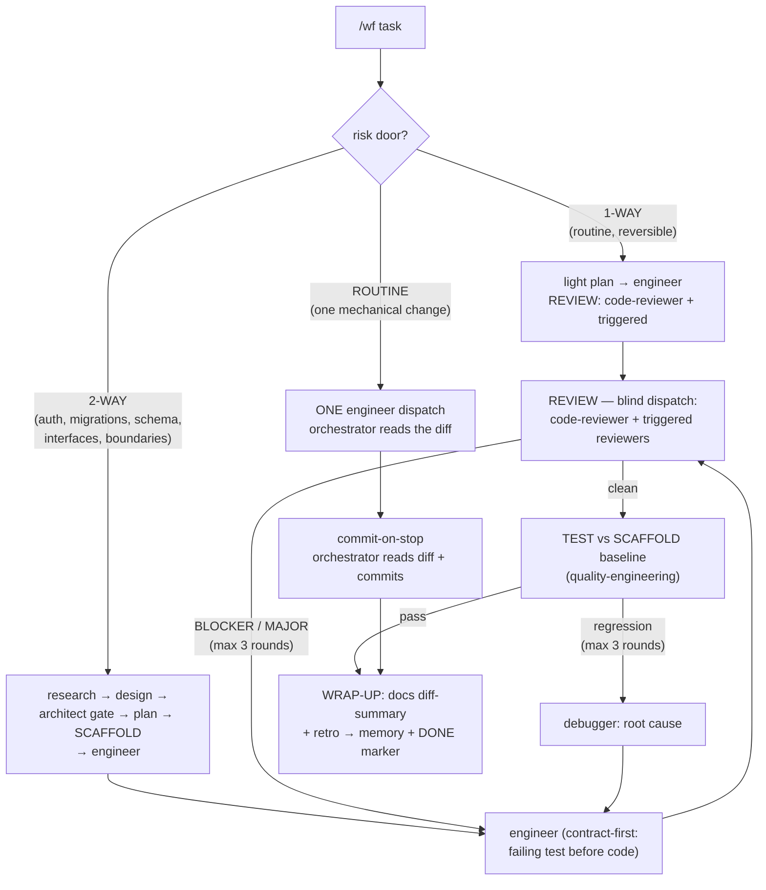

# Agent Framework — OpenCode V2 Software Factory

A portable, self-contained package for rebuilding the **OpenCode V2
multi-agent software factory** on a new machine: one `orchestrator` agent
running a research → design → plan → implement → review → test → wrap-up
pipeline through 24 specialist subagents, with engine-level permission
hardening, per-agent model pins (OpenCode Go Plus), and a tracked work board.

**This folder is the canonical distribution copy.** The live install lives in
`~/.config/opencode/` on each machine. Follow this README top-to-bottom on a
fresh machine and you end up with an identical factory.

Deep documentation (hardening mapping, skill wiring, verification semantics,
trade-off tables, known gaps):
[`docs/opencode-workflow-setup.md`](../../docs/opencode-workflow-setup.md).

Packaged: 2026-10-17 · model pins as of that date · requires **OpenCode V2**.

---

## 1. What the factory does



- **2-WAY** = auth, payments, migrations, schema, public API/interface
  changes, module boundaries, data flows → full pipeline with independent
  architect gates.
- **1-WAY** = routine, trivially reversible → light review, no architect
  gates, no separate SCAFFOLD.
- **ROUTINE** = one mechanical, reversible change → single engineer dispatch;
  the orchestrator reads the diff itself. Requires judgment? Promote up
  (ROUTINE → 1-WAY → 2-WAY), never down.

Every run writes `docs/workflow/<slug>/` in the target repo (`learnings.md`,
`log.md`, `research.md`, `design.md`, `plan.md`, `diff-summary.md`) and closes
with a `DONE:` line in `log.md`. `learnings.md` is force-read by every
dispatch — the factory accumulates lessons across runs.

## 2. Requirements

| Tool | Version | Why | Check |
| --- | --- | --- | --- |
| OpenCode | V2 (any 2.x) | the agent runtime | `opencode --version` |
| Node.js | 22+ (26 tested) | taste-skill scripts, playwright MCP via `npx` | `node --version` |
| Chrome / Edge / Chromium | any recent | taste-skill real-browser inspector | app installed |
| Python | 3.10+ | sync script, `doctor.py` | `python3 --version` |
| GitHub CLI (`gh`) | authenticated | PR flow for factory changes | `gh auth status` |
| OpenCode **Go Plus** | $40/month | all 15 model pins target `opencode-go/*` | console subscription |
| Chrome signed into Google | — | optional: `notebooklm login --browser-cookies` | — |

Optional MCP servers used by the factory (add what you have; hardening denies
are harmless if a server is absent):

```sh
opencode mcp add playwright --global -- npx -y @playwright/mcp@latest   # interaction review (web-ui-reviewer, engineer)
opencode mcp add my-memory --global -- /path/to/my-memory/bin/mem mcp   # retro hook target (orchestrator only)
opencode mcp add notion --global ...                                    # Work Board (orchestrator only)
opencode mcp add xcodebuildmcp --global -- xcodebuildmcp mcp            # iOS test runs (quality-engineering, debugger)
```

Workers that must NOT reach a server are enforced by hardening — see §6.

## 3. Part A — install the workers and skills (this repo)

The 24 specialist workers and all skills come from **this repo** — one clone
covers Claude Code and OpenCode.

```sh
git clone https://github.com/atomsbaza/my-superpowers.git ~/Work/my-superpowers
cd ~/Work/my-superpowers
./install.sh --force        # copies agents/ → ~/.claude/agents/, skills/ → ~/.claude/skills/
python3 tools/agent-evals/scripts/doctor.py --repo .
# → expected: 0 error(s). ERROR findings are blocking — fix before continuing.
```

This gives OpenCode its 24 workers (they read `~/.claude/agents/*.md` through
the sync script) plus the 177 skills, including `taste-skill` (web art
direction) and the knowledge-base set.

## 4. Part B — install the factory package

From this repo (or copy the folder to the target machine first):

```sh
REPO=~/Work/my-superpowers/framework/agent-framework

mkdir -p ~/.config/opencode/agents ~/.config/opencode/commands

# Back up any existing config first — the sync script REGENERATES the
# `agents` key of opencode.json on every run.
[ -f ~/.config/opencode/opencode.json ] && \
  cp ~/.config/opencode/opencode.json ~/.config/opencode/opencode.json.pre-factory

cp "$REPO/orchestrator.md"      ~/.config/opencode/agents/orchestrator.md
cp "$REPO/sync-from-claude.py"  ~/.config/opencode/sync-from-claude.py
cp "$REPO"/commands/*.md        ~/.config/opencode/commands/
```

What each file becomes:

| File | Live location | Role |
| --- | --- | --- |
| `orchestrator.md` | `~/.config/opencode/agents/orchestrator.md` | primary agent: 3-lane pipeline, blind dispatch, stage-boundary commits, model pin `opencode-go/gpt-6-luna` |
| `sync-from-claude.py` | `~/.config/opencode/sync-from-claude.py` | regenerates the `agents` key of `opencode.json` from `~/.claude/agents/*.md` + appends hardening + `MODEL` map |
| `commands/wf*.md` | `~/.config/opencode/commands/` | `/wf`, `/wf-status [slug]`, `/wf-list` |

`opencode.json` itself is **generated** — never hand-edit its `agents` key
(every sync wipes it; per-agent changes go in the sync script's `hardening()`
and `MODEL` sections instead).

## 5. Part C — providers and defaults

1. In OpenCode: `/connect` → paste your **OpenCode Go API key** (console →
   subscribe Go Plus → copy key). OpenCode is a validated Go client; no
   session-header setup needed.
2. Set the session defaults in `~/.config/opencode/opencode.json`:

```jsonc
{
  "model": "opencode-go/glm-5.3-flash",       // interactive default (18,960 req/5h on Plus)
  "small_model": "opencode-go/glm-5.3-flash"  // titles / compaction
}
```

3. Optional console **Privacy → region**: set **Global** if you want
   `deepseek-v4.1-flash` (the research/docs pin). Without Global that model
   errors with "requires Global regions" — everything else works regardless.

## 6. Part D — generate agents + hardening + model pins

```sh
python3 ~/.config/opencode/sync-from-claude.py
# → "agents written: 24; skipped: ['haiku-engineer', 'qa-execution-operator']"
```

The script mirrors `~/.claude/agents/*.md` into `opencode.json`'s `agents`
key and appends, per agent:

- **hardening** — skill/MCP permission denies matched to each role
  (read-only reviewers, playwright scoped to 5 build/verify roles, memory
  writes blocked for all subagents, …)
- **model pins** — the `MODEL` map (OpenCode Go Plus):

| Agent | Pin | Go Plus /5h |
| --- | --- | --- |
| `orchestrator` | `gpt-6-luna` | 16,920 |
| `research`, `docs` | `deepseek-v4.1-flash` | 69,330 |
| `solution-architect`, `architect-reviewer` | `qwen3.8-max` | 640 |
| `tech-lead` | `glm-5.2` | 2,640 |
| `engineer` | `kimi-k2.7-code` | 4,050 |
| `code-reviewer`, `swift-reviewer`, `security-engineer`, `performance-reviewer`, `dependency-reviewer`, `web-ui-reviewer` | `claude-haiku-5-5` | 15,380 |
| `quality-engineering` | `glm-5.3-flash` | 18,960 |
| `debugger` | `glm-5.3` | 1,760 |
| `wiki-updater` | `mimo-v2.6-flash` | 60,200 |
| ROUTINE lane | rides `engineer`'s pin | — |

Unpinned agents (`sre`, `data-engineer`, `ai-engineer`, `api-designer`,
`devops-engineer`, `qa-*`, `explore`, `general`) inherit the session model.

`#variant` effort suffixes do **not** resolve for these models today (no
catalog variants) — pin the plain model id. ZDR note: GLM/Kimi/DeepSeek/
MiMo/Qwen/LongCat retain 0 days; Haiku 5.5 retains 30 days.

## 7. Part D — verify

```sh
opencode api get /api/agent     # agents, modes, effective permissions, model pins
opencode api get /api/command   # wf, wf-status, wf-list must appear
```

Full assertion probe (expected results — run from anywhere):

```python
import json, re, subprocess
data = json.loads(subprocess.check_output(["opencode", "api", "get", "/api/agent"]))
agents = {a["name"]: a for a in data["data"]}
def eff(rules, act, tgt="*"):
    out = None
    for x in rules:
        if match(x["action"], act) and match(x["resource"], tgt): out = x["effect"]
    return out
def match(pattern, value):
    return re.match("^" + re.escape(pattern).replace(r"\*", ".*") + "$", value, re.I) is not None

assert len([a for a in agents.values() if a.get("mode") == "subagent" and not a["name"][0].isupper()]) == 24
o = agents["orchestrator"]
assert o["mode"] == "primary"
assert len([x for x in o["permissions"] if x["action"] == "subagent" and x["effect"] == "allow"]) == 16
w = agents["web-ui-reviewer"]["permissions"]
assert eff(w, "edit") == "deny" and eff(w, "playwright_browser_navigate") == "allow"
assert eff(agents["engineer"]["permissions"], "edit", "src/x.ts") == "allow"
assert "kimi-k2.7-code" in json.dumps(agents["engineer"].get("model", {}))
print("factory verification PASSED")
```

Also confirm `/api/command` lists `wf`, `wf-status`, `wf-list`.

## 8. Part E — run it

In any git project:

```text
/wf migrate the auth module to the new session store
```

The orchestrator classifies the lane, asks about active runs, then walks the
pipeline. Watch progress with `/wf-status`, list everything with `/wf-list`.
On the Notion Work Board (if connected) the task's Owner flips to whichever
agent currently owns the stage.

## 9. Maintenance on an existing machine

Every prompt file has TWO copies that must stay identical:

| Live | Canonical mirror in this repo |
| --- | --- |
| `~/.config/opencode/agents/orchestrator.md` | `framework/agent-framework/orchestrator.md` + `agents/orchestrator.md` (pre-P1 baseline, commit `7e57443`; live edits copy back to both) |
| `~/.config/opencode/sync-from-claude.py` | `tools/mirror/sync-from-claude.py` |
| `~/.config/opencode/commands/*.md` | `framework/agent-framework/commands/` |
| `~/.claude/agents/*.md` (workers) | `agents/*.md` |

Rules:

- Edit one side, `diff` the other, `cp` to keep them identical.
- After editing any `~/.claude/agents/*.md`, re-run the sync script — it
  regenerates the `agents` key (hand edits there are lost on every sync).
- Per-agent permission/model changes go in the script's `hardening()` /
  `MODEL` sections, never in `opencode.json` directly.
- `doctor.py` before committing agent/skill edits — ERROR findings block.
- **Go roster rotates** — re-verify quarterly:
  `opencode run --model opencode-go/deepseek-v4.1-flash "OK"` (nonzero exit →
  region/roster moved; fallback pins are documented in the deep doc §11).

## 10. Gotchas (learned on the reference machine)

- **Nested project roots**: relative allow patterns like `docs/workflow/*`
  fail when the session cwd sits above the project root — the shipped pattern
  is `**/docs/workflow/*` for exactly this reason (probe before wrap: dispatch
  the 3 artifact agents to write scratch files from a nested cwd).
- **Gates read disk**: save the revised artifact to the file BEFORE re-running
  a reviewer — a reviewer reads the file, not your context (a stale file made
  gate round 2 flag already-fixed findings).
- **Sync idempotency gate**: back up `opencode.json`, re-run the sync, and
  `diff` against the backup — if anything other than the intended permission
  rows changed, STOP and investigate before touching anything else.
- **One pipeline per session** — interleaving two runs tangles stage state;
  concurrency goes through separate sessions/worktrees (`/wf` asks).
- **Notion free tier**: Query Data Source has a rolling quota; comment
  deletion needs Business. Create/update/comment still work fine.
- **Blind cost, accepted**: the engineer's "noticed but did not touch"
  observations never reach reviewers — deliberate, to keep reviews unbiased.

## 11. File map (this folder)

```text
framework/agent-framework/
├── README.md                 # this guide
├── orchestrator.md           # primary agent (copy → ~/.config/opencode/agents/)
├── sync-from-claude.py       # sync + hardening + MODEL map (copy → ~/.config/opencode/)
└── commands/
    ├── wf.md                 # /wf
    ├── wf-status.md          # /wf-status [slug]
    └── wf-list.md            # /wf-list
```

## 12. Design decisions (short form)

- Workflow files live **outside** `opencode.json` — the sync rewrites the
  `agents` key wholesale; anything hand-edited there dies on the next sync.
- Orchestrator is **coordination-only**: dispatch, verify on disk, commit.
  Never produces artifacts itself — unrelated work goes to a subagent or back
  to the user.
- **Engineer never commits** — the orchestrator is the sole committer, at
  stage boundaries, on the run's branch, never pushing.
- **Reviewers are blind** — spec/plan artifacts and changed files only; the
  implementer's report is never materialized for them (cost: "noticed but did
  not touch" observations are an accepted loss).
- **Memory writes stay out of subagents** — untrusted-content digestors must
  never reach the memory store (persistent injection channel).
- Consent question for non-default models always offers
  **"use the agent pins"** as option 1 (each role → its pinned model).
